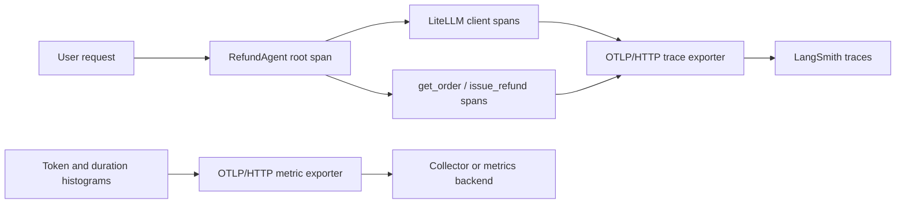

# Refund Agent

Refund Agent is an early-stage, typed Python agent that evaluates refund
requests and records eligible mock refunds in a local JSON order store. The
core is kept small and provider-neutral so policy and payment integrations can
evolve independently.

> **Status:** pre-alpha. This project does not connect to a payment provider,
> authenticate users, or issue real refunds yet. Do not use it for production
> financial decisions without adding authentication and authorization, durable
> transactional persistence, audit controls, and provider-specific safeguards.

## Features

- Typed agent results and Pydantic-validated `get_order` and `issue_refund` tools
- Deterministic refund policy, idempotent updates, and explicit safety boundaries
- Repeated behavioral evaluations with `pass@k`, `pass^k`, tool-use assertions,
  and token accounting
- OpenTelemetry GenAI traces exported to LangSmith and OTLP metrics for a
  compatible metrics backend
- Opt-in prompt and response capture with redaction and size limits
- Strict linting, formatting, typing, tests, coverage, packaging, and CI

## What this project demonstrates

This repository separates behavior that must be deterministic from behavior
delegated to an LLM. Python code owns validation, policy decisions, persistence,
idempotency, and outcome mapping. The model is responsible for interpreting the
request, choosing tools, and writing the user-facing response.

The evaluation and observability layers make that boundary inspectable. The
evaluator catches both incorrect outcomes and inefficient tool behavior, while
OpenTelemetry traces show the model calls and tool executions that produced a
result. This makes regressions such as issuing a second refund request for an
already-refunded order visible instead of treating a plausible final sentence
as sufficient evidence of correctness.

## Quick start

Requires Python 3.12 or newer.

```bash
make setup
test -f .env || cp .env.example .env
# Edit .env and set MODEL_ID plus the credential required by your provider.
.venv/bin/refund-agent check \
  --order-id 123 \
  --orders-file orders.json
```

The command only prints an eligibility decision; it never issues a refund.

Run the LiteLLM-powered agent with the model configured in `.env`:

```bash
make run
```

`make run`, `make eval`, and the quality commands automatically use
`.venv/bin/python` when the virtual environment exists. Run `make setup` after
dependency changes so that optional integrations such as OpenTelemetry are
installed in that environment.

The command keeps prompting and passes each message to the same `RefundAgent`.
Enter `quit` or `exit` to end the session:

```text
You: Can you refund order 101?
Refund Agent [refunded]: ...
You: exit
Goodbye.
```

You can also activate the environment and call the installed command directly:

```bash
source .venv/bin/activate
refund-agent-chat
```

## Behavioral evaluations

The evaluator treats an agent response as more than text. A run can assert the
structured refund outcome, exact tool sequence, and maximum number of tool
calls. It separately reports token usage and LLM/tool-call counts for cost and
latency analysis.

| Signal | What it answers | Affects pass/fail |
| --- | --- | --- |
| Expected outcome | Did the agent return the required `RefundOutcome`? | Yes |
| Expected tools | Did it call the correct tools in the correct order? | Yes |
| Maximum tool calls | Did it avoid redundant work? | Yes |
| Single-run accuracy | What fraction of all attempts passed every assertion? | Summary |
| `pass@k` | Did each case pass at least once across `k` attempts? | Summary |
| `pass^k` | Did each case pass on every one of the `k` attempts? | Summary |
| Tokens and call counts | What did the run cost, and how much work did it do? | No |

Run every case three times:

```bash
make eval
```

Choose a different number of attempts:

```bash
make eval K=5
```

To invoke the evaluation script directly without activating the environment,
use the virtual environment's interpreter:

```bash
PYTHONPATH=src .venv/bin/python eval/run_eval.py --k 3
```

Use the virtual-environment interpreter because OpenTelemetry and the other
runtime dependencies are installed there. Each attempt receives a fresh
temporary copy of `orders.json`, preventing a refund in one attempt from
changing later results.

Evaluation cases live in `eval/eval.json`. Each case requires an expected
outcome and can constrain tool behavior:

```json
{
  "input": "Refund order 456",
  "expected": "denied",
  "expected_tools": ["get_order", "issue_refund"],
  "max_tool_calls": 2
}
```

The included dataset covers eligible refunds, policy denials, already-refunded
orders, missing orders, and requests without an order ID. Scoring is
deterministic and assertion-based rather than LLM-as-judge, so a model change
can be compared against the same behavioral contract.

For example, an already-refunded order expects only `get_order`. If the model
also calls `issue_refund`, the final outcome may still be correct, but the run
fails its tool-sequence and tool-count assertions. This distinction is useful
for detecting unnecessary or unsafe agent behavior that response-only scoring
would miss.

The report includes, per attempt and in aggregate:

- expected and actual structured outcomes;
- exact tool sequence and total tool calls;
- LLM calls and prompt, completion, and total tokens;
- single-run accuracy, `pass@k`, and `pass^k`;
- assertion-level failure reasons.

Response wording and token totals do not determine pass/fail. This keeps the
core evaluation deterministic while still exposing efficiency data for model
and prompt comparisons.

Failed runs and assertion details are shown in red when output is attached to a
color-capable terminal. Use `--color=always` to force color or `--color=never`
to disable it; the standard `NO_COLOR` environment variable is also respected.

## Observability: OpenTelemetry to LangSmith

The agent is instrumented directly with OpenTelemetry rather than a
framework-specific tracing wrapper. Spans and metrics use GenAI semantic
attributes and are exported over OTLP/HTTP. LangSmith receives the traces;
standard OpenTelemetry endpoint variables can route metrics to a compatible
backend or collector.



Configure LangSmith in `.env`:

```dotenv
LANGSMITH_API_KEY=replace-me
LANGSMITH_PROJECT=refund-agent
LANGSMITH_ENDPOINT=https://api.smith.langchain.com
# Required when an API key can access more than one workspace:
# LANGSMITH_WORKSPACE_ID=workspace-id
OTEL_SERVICE_NAME=refund-agent

# Optional but recommended: LangSmith currently accepts OTLP traces, not metrics.
# Point metrics at a collector or metrics backend that accepts OTLP/HTTP.
# OTEL_EXPORTER_OTLP_METRICS_ENDPOINT=http://localhost:4318/v1/metrics
```

### Trace model

| Span | Selected attributes | Purpose |
| --- | --- | --- |
| Agent | `gen_ai.operation.name=invoke_agent`, model, final refund outcome, aggregate calls and tokens | Correlates one user request |
| LLM client | `gen_ai.operation.name=chat`, provider, request/response model, response ID, finish reasons, token usage | Explains model behavior and cost |
| Tool | `gen_ai.operation.name=execute_tool`, tool name/type, call ID, JSON arguments and result | Shows exactly what local operation ran |

One agent invocation creates a root agent span, a child span for each LiteLLM
request, and a child span for each tool execution. Tool inputs and outputs use
`gen_ai.tool.call.arguments` and `gen_ai.tool.call.result`. Tool failures also
set the span error status and `error.type`.

The meter records two histograms:

- `gen_ai.client.token.usage` in `{token}`, separated by
  `gen_ai.token.type=input|output`;
- `gen_ai.client.operation.duration` in seconds.

The trace attributes make it possible to correlate an evaluation failure with
its model calls, tool choices, and token consumption in LangSmith. The
histograms support aggregate token and latency analysis in the configured
metrics backend.

### Content capture and privacy

LLM prompt and response content is disabled by default because it can contain
sensitive data. Enable it for troubleshooting or controlled evaluations:

```dotenv
REFUND_AGENT_TRACE_CONTENT=true
```

When enabled, model spans record `gen_ai.system_instructions`,
`gen_ai.input.messages`, and `gen_ai.output.messages` as JSON. Common credential
fields are redacted, and each content attribute is capped at 16,384 characters.
Redaction is a safeguard, not a guarantee that free-form text contains no
sensitive data. Tool arguments and results can also contain order information.
Keep LangSmith access restricted and use an appropriate retention policy.

### Export controls

Standard `OTEL_EXPORTER_OTLP_ENDPOINT`, per-signal endpoints, and
`OTEL_EXPORTER_OTLP_HEADERS` override the derived settings. When only LangSmith
credentials are configured, the application exports traces to LangSmith and
keeps metrics local. LangSmith currently supports OpenTelemetry trace
ingestion, not OTLP metrics. Set
`OTEL_EXPORTER_OTLP_METRICS_ENDPOINT` to an OpenTelemetry Collector or another
metrics backend; input and output token counts remain available as attributes
on the LangSmith model spans.

See the [LangSmith OpenTelemetry announcement](https://www.langchain.com/blog/opentelemetry-langsmith)
and the [OTLP exporter specification](https://opentelemetry.io/docs/specs/otel/protocol/exporter/)
for the underlying transport conventions. Set `REFUND_AGENT_OTEL_EXPORT=false`
to retain instrumentation while disabling network export. The test suite sets
this automatically so tests never send developer telemetry.

## VS Code debugging

Open the `refund_agent` directory as the VS Code workspace, install the
recommended Python, Debugpy, and Ruff extensions, then select a profile from
the **Run and Debug** panel:

- `Refund Agent: Interactive Chat`
- `Refund Agent: Check Order 123`
- `Refund Agent: Run Evaluations`
- `Python: Debug Current Test File`
- `Python: Debug Full Test Suite`

The workspace selects `.venv/bin/python`, loads `.env`, and adds `src/` to the
Python import path automatically. Add breakpoints and press **F5** to start.

Refund requests without a numeric order ID return the deterministic status
`needs_order_id` before any LLM or tool call is made.

Programmatic calls return a validated status and message separately:

```python
result = await agent.run_agent("Refund order 123")
if result.status is not None:
    print(result.status.value)
print(result.message)
```

`status` is the exact outcome from a validated refund result. Deterministic
request-validation outcomes include `needs_order_id` and `order_not_found`. It
is `None` when no valid refund outcome was produced; the agent does not invent
an `unknown` or `rejected` outcome.

## Agent tools

The local tools use `orders.json` by default and return validated Pydantic
models:

```python
from refund_agent import get_order, issue_refund

order = get_order("123")
result = issue_refund("123")
```

`issue_refund` only records an eligible mock refund in `orders.json`; it does
not contact a payment provider. Orders older than 30 days are denied, and
already-refunded orders produce an idempotent no-op result. Use
`GetOrderInput.model_json_schema()` and `IssueRefundInput.model_json_schema()`
to expose their strict argument schemas to an agent framework.

The package also exports a ready-to-use system message:

```python
from refund_agent import REFUND_AGENT_SYSTEM_MESSAGE
```

It instructs the agent to look up authoritative order data, obtain confirmation
before recording a refund, follow `RefundPolicy`, avoid duplicate tool calls,
and clearly disclose that this project does not move real money.

## Development

Run all local quality checks:

```bash
make check
```

Individual commands are available as `make lint`, `make typecheck`, `make test`,
and `make build`. Install the optional Git hooks with `pre-commit install`.

## Architecture

```text
refund_agent/
├── eval/
│   ├── eval.json       # behavioral cases and tool-use expectations
│   └── run_eval.py     # repeated evaluation and reliability reporting
└── src/refund_agent/
    ├── agent.py        # LiteLLM loop, tool dispatch, and GenAI spans
    ├── telemetry.py    # OTLP trace/metric exporters and instruments
    ├── system_message.py
    ├── order.py        # validated order value object
    ├── order_service.py # atomic JSON persistence
    ├── tools.py        # Pydantic-validated agent tools
    ├── policy.py       # deterministic eligibility rules
    ├── service.py      # payment-gateway boundary
    └── cli.py          # dry-run command-line interface
```

`RefundPolicy` evaluates an immutable `Order` value object. `RefundService`
accepts that policy and a `RefundGateway` implementation. Keeping those
dependencies explicit makes provider adapters straightforward to test without
live API calls.

## Configuration and runtime data

Set `MODEL_ID` in `.env` to the LiteLLM model identifier passed to
`RefundAgent`, for example `openai/your-model-name`. Provider credentials also
belong in the untracked local `.env` or a secret manager; `.env.example` must
contain placeholders only. The mock `issue_refund` tool atomically updates
`orders.json`, so use a disposable copy in tests and never log credentials,
payment data, or sensitive customer data.

## Security

See [SECURITY.md](SECURITY.md) for private vulnerability reporting guidance.
Refund and payment systems require careful authorization, idempotency, privacy,
and audit controls; those production controls are intentionally not claimed here.

## Contributing

See [CONTRIBUTING.md](CONTRIBUTING.md).

## License

No license has been selected yet. Until one is added, copyright law reserves all
rights and public reuse is not granted.
